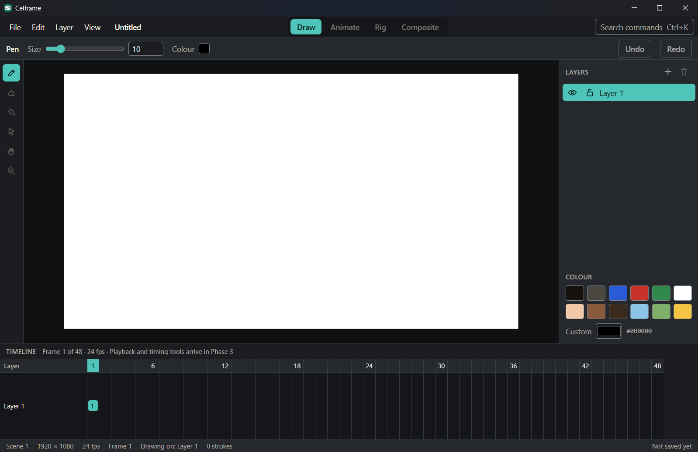
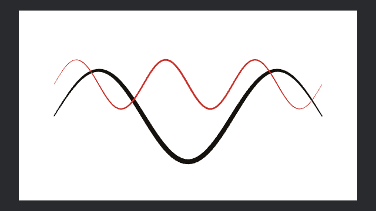

<h1>
  <picture>
    <source media="(prefers-color-scheme: dark)" srcset="docs/brand/logo-light.svg">
    
  </picture>
</h1>

Free, open-source 2D animation studio: clean-room, modern, built for students.



## Why Celframe

Professional 2D animation tools are expensive, and students often learn on whatever they can afford. Celframe aims to cover the same range of work, from frame-by-frame drawing and timing to cut-out rigging, compositing and export, in a tool that is free for everyone, forever, under the GPL.

It is built from general animation knowledge and our own specs, never from another product's code, files or documentation. See [CLEANROOM.md](CLEANROOM.md).

## Status

Celframe is in **Phase 1: Foundation**. You can draw pressure-sensitive strokes on layers, zoom, pan and rotate the canvas, undo and redo everything, and save, open and recover `.celf` projects. It isn't ready for real animation work yet.



The [feature inventory](docs/features/inventory.md) lists everything planned, phase by phase, and the [roadmap board](https://github.com/users/dshepstone/projects/2) tracks the work.

## Build and run

You need:

- [Rust](https://rustup.rs/). The toolchain version is pinned in `rust-toolchain.toml` and installs automatically.
- [Node.js](https://nodejs.org/) 22 or newer, and [pnpm](https://pnpm.io/) 10.
- On Linux, the WebKitGTK and GTK development libraries:
  `sudo apt-get install libwebkit2gtk-4.1-dev libayatana-appindicator3-dev librsvg2-dev patchelf`
- On Windows, the WebView2 runtime, which Windows 11 already has.

Then, from the repository folder:

```bash
pnpm install
```

```bash
pnpm --filter @celframe/desktop tauri dev
```

The first start compiles the Rust code and takes a few minutes.

Known issue: on Linux the canvas area can appear black, because the web layer paints over the native canvas there ([#20](https://github.com/dshepstone/celframe/issues/20)). Windows works, and macOS hasn't been tested on hardware yet.

## Using it

| Action                   | How                                                 |
| ------------------------ | --------------------------------------------------- |
| Draw                     | Pen tool (`P`), with a pen, mouse or touch          |
| Pan                      | Pan tool (`H`), middle-drag, or hold Space and drag |
| Zoom                     | Mouse wheel, `+` and `-`, or the Zoom tool (`Z`)    |
| Rotate the view          | `,` and `.`                                         |
| Fit the scene            | `0`                                                 |
| Undo, redo               | `Ctrl+Z`, `Ctrl+Shift+Z`                            |
| New, open, save, save as | `Ctrl+N`, `Ctrl+O`, `Ctrl+S`, `Ctrl+Shift+S`        |
| Find any command         | `Ctrl+K`                                            |

On macOS, use `Cmd` instead of `Ctrl`.

## Tests

```bash
cargo nextest run --workspace
```

```bash
pnpm test
```

## Project layout

| Folder                   | What it holds                                         |
| ------------------------ | ----------------------------------------------------- |
| `crates/celframe-core`   | Document model, commands, undo and redo               |
| `crates/celframe-geom`   | Stroke smoothing and tessellation                     |
| `crates/celframe-render` | GPU renderer (wgpu)                                   |
| `crates/celframe-format` | The `.celf` file format ([spec](docs/file-format.md)) |
| `apps/desktop`           | The desktop app: Tauri 2, React and TypeScript        |
| `packages/ui`            | Design tokens, components and Storybook               |
| `docs`                   | Decisions (`adr`), feature specs (`specs`), inventory |

## Contributing

Contributions are welcome, especially from students. Read [CONTRIBUTING.md](CONTRIBUTING.md) and [CLEANROOM.md](CLEANROOM.md) first, and follow the [code of conduct](CODE_OF_CONDUCT.md).

## Licence

[GPL-3.0-or-later](LICENSE).
